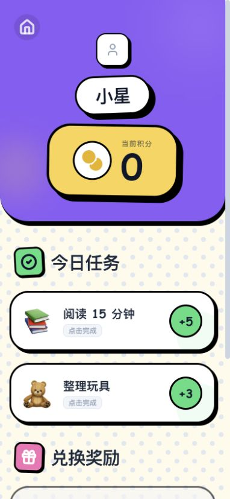
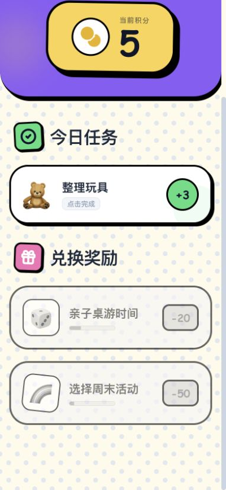
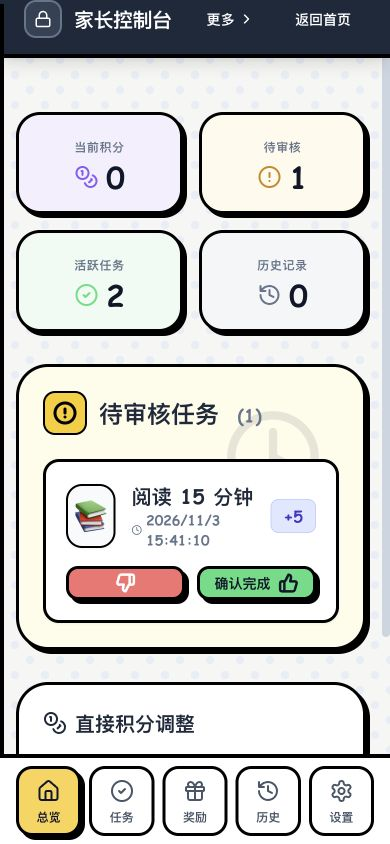
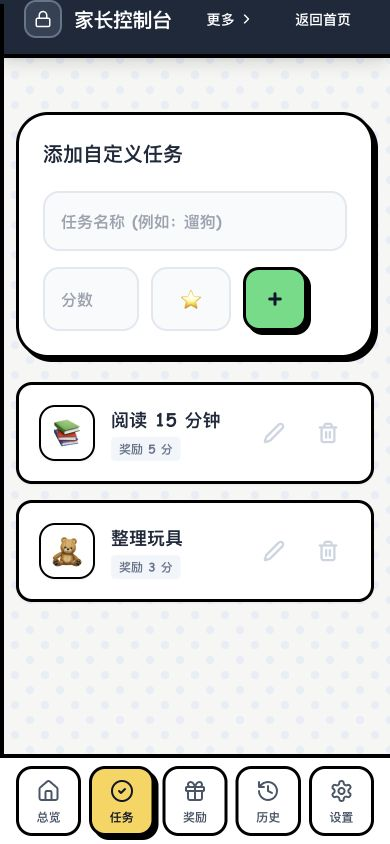

# Habit Hero

[简体中文](README.md) · [Deployment guide](docs/DEPLOY.en.md) · [MIT license](LICENSE)

**Turn everyday habits into progress children can see.**

Habit Hero is a family habit and rewards app you can host on your computer, NAS, or server. Parents set tasks and rewards. Children submit completed tasks, parents approve them, and children spend their earned points on agreed rewards.

For example: earn 5 points for 20 minutes of reading, then exchange 30 points for a family movie night.

Open it in a phone browser—no app installation needed. Manage multiple children and invite another parent to help. Your data stays on your own service. This project includes the **web app and backend**. The app UI is currently Chinese; documentation is available in Chinese and English.

## For children

- **Complete tasks**: see daily habits and submit them for approval.
- **See progress**: check personal points and task completion.
- **Choose rewards**: exchange points for rewards set by parents.

| My tasks | Reward shop |
| :---: | :---: |
|  |  |

## For parents

- **Plan habits**: create tasks for each child, or add optional starter tasks and rewards.
- **Approve progress**: review submissions and manage points and rewards.
- **Work together**: invite another parent, view history, and import or back up family data.
- **Give children their own access**: create a child device code restricted to that child's tasks and rewards.

| Task approval | Habit management |
| :---: | :---: |
|  |  |

> Screenshots show the actual app with demo data in a phone-sized browser viewport. They are not captures from a physical phone.

## One-command setup

Install and start **Docker with Compose v2**. Use macOS, Linux, or a NAS; on Windows, run these commands in WSL2. Bash and OpenSSL are also required. The first run downloads images and dependencies.

Download and extract the source, enter the `habit-hero` folder, and run:

```sh
bash deploy.sh
```

Choose whether phones on your trusted local network can connect, then set your parent username and password. The script generates configuration, starts the services, and prints the access addresses. No separate database installation or third-party API key is needed.

- **Computer**: open `http://127.0.0.1:4319`.
- **Phone**: allow LAN access during setup, connect to the same network, and open the printed phone address.
- **Remote access**: configure your own domain and HTTPS using the [deployment guide](docs/DEPLOY.en.md).

Running the script again preserves existing configuration, accounts, and data. Public registration is off by default. There is no default password; choose at least 10 characters. Intended for family self-hosting.

## Start using it

1. **Log in as a parent**, create a family, and add a child.
2. Open **家长入口 → 设置 → 添加示例任务与奖励** to add starter tasks and rewards, or create your own.
3. Generate a **child device code** in settings. On the child's device, choose **儿童设备登录** on the login page. For a shared device, choose **将本浏览器切换为儿童设备**.
4. The child submits a completed task, a parent approves it, and the child can spend the earned points on rewards.

## More

[Deployment, updates, and backups](docs/DEPLOY.en.md) · [Security](SECURITY.md) · [Third-party licenses](THIRD_PARTY_NOTICES.md)

Licensed under [MIT](LICENSE). Adapt it to fit your family.
