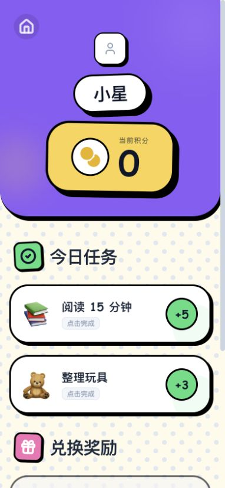
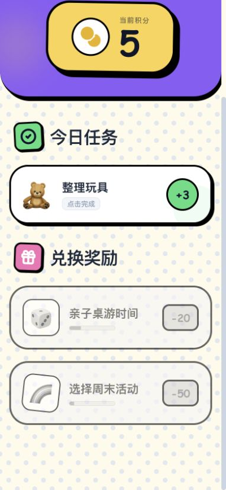
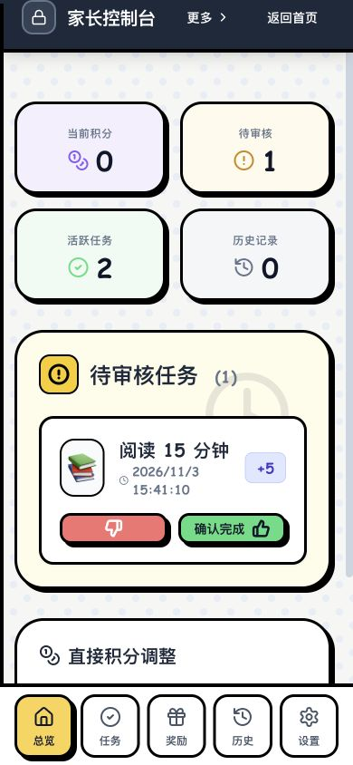
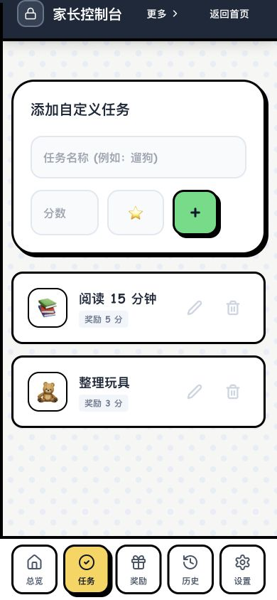

# Habit Hero · 习惯小英雄

[English](README.en.md) · [部署文档](docs/DEPLOY.zh-CN.md) · [MIT 许可证](LICENSE)

**把每天的小习惯，变成孩子看得见的成长。**

Habit Hero 是一个可以部署在自己电脑、NAS 或服务器上的亲子习惯养成应用。家长设置任务和奖励，孩子完成任务后提交，家长确认后发放积分，孩子再用积分兑换约定的奖励。

比如：每天阅读 20 分钟得 5 分，积攒 30 分兑换一次家庭电影时间。

手机浏览器打开即可使用，无需安装 App。支持多个孩子和家长共同管理，数据保存在你自己的服务里。当前提供 **H5 网页端 + 服务端**；应用界面为中文，文档提供中英文。

## 儿童端

- **做任务**：查看每天的习惯，完成后提交给家长确认。
- **看成长**：查看自己的积分和任务完成情况。
- **换奖励**：用积分兑换家长设置的奖励。

| 我的任务 | 奖励商店 |
| :---: | :---: |
|  |  |

## 家长端

- **安排习惯**：为不同孩子设置任务，也可一键添加示例任务和奖励。
- **确认成果**：审批孩子提交的任务，管理积分与奖励。
- **一起陪伴**：邀请另一位家长协作，查看记录，导入或备份家庭数据。
- **孩子独立使用**：生成儿童设备码，孩子只能操作自己的任务和奖励。

| 任务审批 | 习惯管理 |
| :---: | :---: |
|  |  |

> 截图来自实际应用的手机尺寸浏览器预览，使用演示数据；不是手机实机截图。

## 一键部署

先安装并启动 **Docker（含 Compose v2）**。支持 macOS、Linux 和 NAS；Windows 请在 WSL2 中执行。终端还需有 Bash、OpenSSL，首次运行需要联网下载镜像和依赖。

下载并解压源码，进入 `habit-hero` 文件夹，运行：

```sh
bash deploy.sh
```

按提示选择是否允许同一局域网的手机访问，设置家长用户名和密码。脚本会自动生成配置、启动服务，并显示访问地址。无需另装数据库，也不需要第三方 API Key。

- **电脑**：打开 `http://127.0.0.1:4319`。
- **手机**：选择允许局域网访问后，连接同一网络，打开脚本显示的手机地址。
- **外网使用**：按[部署文档](docs/DEPLOY.zh-CN.md#3-局域网nas-与-https)配置自己的域名和 HTTPS。

再次运行会保留已有配置、账户和数据。默认关闭公开注册；没有默认密码，密码至少 10 位。适合家庭自托管使用。

## 开始使用

1. **家长登录**，创建家庭并添加孩子。
2. 打开 **家长入口 → 设置 → 添加示例任务与奖励**，也可以自己编辑。
3. 在设置中生成 **儿童设备码**，让孩子在另一台设备的登录页选择「儿童设备登录」。共用设备时可直接「将本浏览器切换为儿童设备」。
4. 孩子完成任务后提交，家长审批，积分到账后就能兑换奖励。

## 更多

[详细部署、更新与备份](docs/DEPLOY.zh-CN.md) · [安全说明](SECURITY.md) · [第三方许可](THIRD_PARTY_NOTICES.md)

采用 [MIT](LICENSE) 许可证，欢迎按自己家庭的需要修改。
